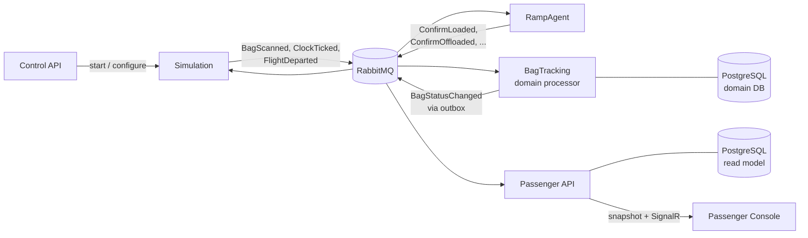

# Beltline

**An event-driven baggage tracking simulation in .NET 10, based on IATA Resolution 753.**

Beltline simulates the journey of checked baggage through an airport, from drop-off to aircraft loading, and tracks every bag in a system built around reliability: no lost events, no double processing, and every bag ending in a definitive final state. Passengers can follow the status of their own bags live.

> **Status:** early development. The design is complete; implementation of v1 has started with the domain model. See [Roadmap](#roadmap).

---

## Why this project

Modern baggage handling is moving towards RFID tracking, edge processing and event-driven integration. Beltline explores what it takes to build such a system in a way that holds up under failure and load. It is a learning and portfolio project focused on:

- Event-driven architecture with commands, events and pub/sub
- Reliable messaging: transactional outbox, idempotent consumers, optimistic concurrency
- Explicit domain modelling with a forward-only state machine
- Simulated time, so the world can run faster than real time without breaking time-based rules

## Core concepts

### A bag's journey

The lifecycle follows the IATA 753 tracking points. In v1, a bag moves through:

```
Bag registered → Dropped off → Inducted → Screening pending → Screening in progress → Screening cleared
  → Sorting → Sorted → Awaiting loading → Load authorized → Loading → Loaded → Departed
```

Alternative paths include **Security hold**, **Offloading** (for example a passenger who did not board) and a departure sweep for bags that did not make the flight.

**Final states:** `Departed`, `Missed`, `Offloaded` (with reason), `Missing`.

Physical confirmations (a bag is loaded, a bag is offloaded) require a manual action by a ramp agent, so the automated chain can never mark physical work as done on its own.

### Bags, legs and flights

- **Bag:** the physical bag (identity only, no status)
- **BagLeg:** one bag on one flight. Holds the current status, the full event history and a version number.
- **FlightHandling:** all baggage handling for one flight (outbound in v1, inbound later)

### Reliability guarantees

| Requirement | How |
|---|---|
| No lost events | Durable broker, acknowledge only after commit, transactional outbox |
| No double processing | Source-assigned event ids, deduplicated on receipt (inbox) |
| Every bag reaches a final state | Departure sweep driven by the simulated `FlightDeparted` event |
| Correct order | Forward-only status; late or invalid input is recorded but never moves a bag backwards |
| No mixed-up flights | Every event carries its flight id; each bag belongs to exactly one leg per flight |
| Stuck bags are noticed | A bag is marked *Late* when it fails to reach a checkpoint that its peers have reached |

## Architecture



| Component | Responsibility |
|---|---|
| `Beltline.ControlApi` | Control plane: create flights and passengers, start and clean up simulations |
| `Beltline.Simulation` | The physical world: belts, scanners, machines, departure, simulated clock |
| `Beltline.BagTracking` | Domain processor and single writer of bag state; inbox, state machine, outbox |
| `Beltline.BagTracking.Domain` | The state machine and domain rules; pure, without infrastructure |
| `Beltline.RampAgent` | Simulated ground staff sending confirmation commands |
| `Beltline.PassengerApi` | Read side: its own read model, snapshots and live updates via SignalR |
| `Beltline.PassengerConsole` | Lightweight passenger view |
| `Beltline.Contracts` | Shared message contracts (events and commands) |

## Tech stack

- .NET 10 (C#)
- NServiceBus on RabbitMQ
- PostgreSQL with EF Core (Npgsql)
- ASP.NET Core and SignalR
- Docker and Docker Compose
- xUnit v3 and Shouldly

## Roadmap

**v1**
- [ ] Domain model and state machine (`Beltline.BagTracking.Domain`)
- [ ] Simulation of drop-off through aircraft loading
- [ ] Domain processor with outbox and inbox
- [ ] Passenger API and console with live updates
- [ ] Control API and RampAgent
- [ ] Local setup with Docker Compose

**Later**
- Inbound handling (unloading and reclaim) and transfer bags
- Bag reconciliation for load authorization
- Role-based views for baggage managers and operations
- Manual RampAgent interface
- Integration and end-to-end tests in CI
- Authentication for passenger access

## Getting started

Not available yet. Instructions follow once the first runnable components are in place.
