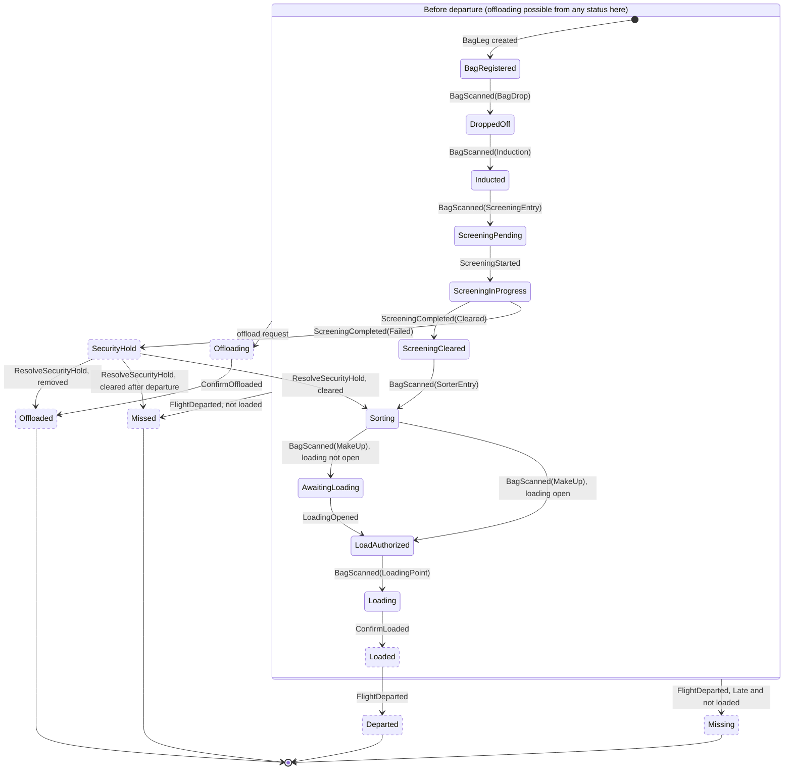
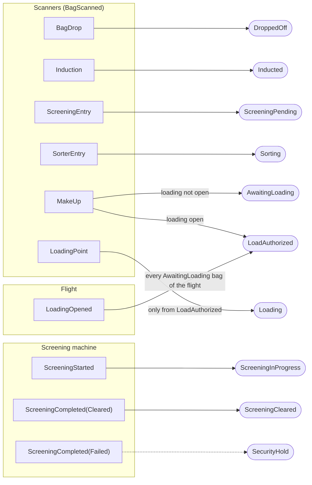
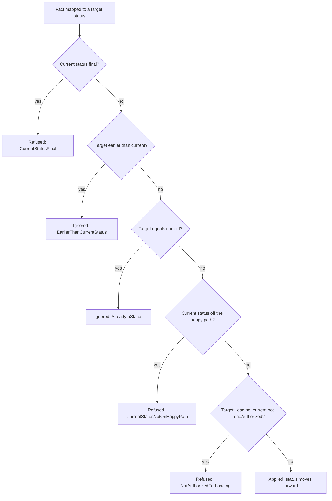

# Bag lifecycle

This document shows how a `BagLeg` (one bag on one flight) moves through its statuses, and which
fact from the simulated world leads to which status. The simulation reports **facts** (where a bag
was seen, what a machine concluded, what happened to a flight); the domain decides which
**status** that means.

Keep this document up to date in the pull request of every issue that changes the lifecycle.

## Rules

- **Forward-only.** A fact is only applied when its status comes later in the happy path than the
  current status. Earlier or equal facts (out-of-order or duplicate messages) leave the bag
  unchanged, but are still recorded (see [Outcomes and history](#outcomes-and-history)).
- **Skipping is allowed.** A missed scan must not block a bag: a later fact moves the bag forward
  past the statuses in between. The diagram does not draw these skip arrows.
  **Exception:** a bag can only reach `Loading` from `LoadAuthorized`. No unauthorized bag may end up
  on board (IATA 753).
- **Explicit order.** "Later" is defined by an explicit list of happy-path statuses in
  `BagLegStateMachine`, not by the order of the `BagStatus` enum.
- **Final statuses never change:** `Departed`, `Offloaded` (with reason), `Missed`, `Missing`.
- **Physical work needs a manual confirmation.** `Loaded` and `Offloaded` are only reached through a
  command from a ramp agent, so the automated chain never marks physical work as done on its own.
- **Late is a condition, not a status.** A bag that fails to reach its next checkpoint in time is
  marked *Late* (`IsLate`, `LateSince`) but keeps its status and can still move forward. Bags on
  security hold are never marked Late.

## Status lifecycle

Solid states can already be reached in code; dashed states are planned.

### Departure

When the simulation reports `FlightDeparted`, every bag of that flight that is not final yet is
resolved as below. The diagram only draws the main departure arrows; this table is complete.

| Status at departure | Result |
| --- | --- |
| `Loaded` | `Departed` |
| `BagRegistered` (never dropped off) | `Offloaded`, reason: not checked in |
| `SecurityHold` | Unchanged; resolved later by `ResolveSecurityHold` (removed → `Offloaded`, cleared → `Missed`) |
| `Offloading` | Unchanged; resolved later by `ConfirmOffloaded` → `Offloaded` |
| Any other status, Late | `Missing` (v1: automatic; a ramp agent may resolve a recovered bag to `Missed`) |
| Any other status, not Late | `Missed` |

`Offloading` can be entered from every non-final status before departure, including `Loaded` (for
example a passenger who did not board), except from `SecurityHold`: a held bag is removed through
its hold resolution instead. The command that starts offloading is defined in the Offloading issue.

## Facts and checkpoints → statuses

Which fact from the simulated world leads to which status. Solid arrows are implemented; dashed
arrows are planned.

`BagRegistered` is not caused by a fact: it is the starting status of every new `BagLeg`.

## Outcomes and history

Every fact that reaches a bag is recorded, whether or not it changed the status. Nothing is
silently dropped: an ignored or refused fact stays visible to operators and for debugging. The
reasoning behind this is recorded in
[ADR 0001](../architecture/adr/0001-forward-only-status-with-full-event-history.md).

### Outcomes

Each fact gets exactly one outcome:

| Outcome | Meaning | Status and version |
| --- | --- | --- |
| `Applied` | The status moved forward. | Status changes, version + 1 |
| `Ignored` | Harmless and expected: an earlier or repeated fact, or a fact that is not supported yet. | Unchanged |
| `Refused` | Not allowed in the bag's current state. Worth attention, e.g. an unauthorized loading scan. | Unchanged |

### Reasons

An entry that is not `Applied` carries a reason. Every reason belongs to exactly one outcome, so
the outcome is derived from the reason and an entry can never contradict itself.

| Reason | Outcome | Example |
| --- | --- | --- |
| `None` | `Applied` | `BagScanned(SorterEntry)` for an `Inducted` bag (skipping is allowed) |
| `EarlierThanCurrentStatus` | `Ignored` | A delayed `BagScanned(BagDrop)` for a bag that is already `Sorting` |
| `AlreadyInStatus` | `Ignored` | A second `BagScanned(Induction)` for an `Inducted` bag |
| `NotSupportedYet` | `Ignored` | `ScreeningCompleted(Failed)`: `SecurityHold` is not implemented yet |
| `CurrentStatusFinal` | `Refused` | Any fact for a bag that has `Departed` |
| `CurrentStatusNotOnHappyPath` | `Refused` | A scan for a bag in `SecurityHold` or `Offloading` |
| `NotAuthorizedForLoading` | `Refused` | `BagScanned(LoadingPoint)` for a bag that is not `LoadAuthorized` |

The checks run in this order; the first one that matches decides the outcome:

`ScreeningCompleted(Failed)` does not go through these checks: it is recorded as `Ignored` with
`NotSupportedYet` until `SecurityHold` is implemented.

### History entries

Each recorded fact becomes an immutable `BagLegHistoryEntry` on the `BagLeg`. Entries are only
appended, in the order the facts are applied, and the history can only be read from outside the
domain.

| Field | Content |
| --- | --- |
| `BagLegId` | The bag leg the entry belongs to |
| `FactType` | `BagScanned`, `ScreeningStarted`, `ScreeningCompleted` or `LoadingOpened` |
| `OccurredAt` | When the fact happened in the simulated world (not when it was processed) |
| `PreviousStatus`, `CurrentStatus` | The status before and after the fact (equal when not applied) |
| `Version` | The bag leg's version after the fact |
| `Outcome`, `Reason` | See above |
| `Checkpoint` | Only for `BagScanned` |
| `ScreeningResult` | Only for `ScreeningCompleted` |

A few cases work differently:

- **`LoadingOpened`** is a flight-level fact. It adds an entry only to the bags it authorizes (from
  `AwaitingLoading` to `LoadAuthorized`); other bags of the flight get no entry. A repeated
  `LoadingOpened` for a flight that is already open records nothing.
- **Repeated facts** each get their own entry. True duplicate messages are filtered before the
  domain (inbox), and the simulation debounces scans, so this stays limited.
- **Caller bugs are not outcomes.** A fact or bag that belongs to a different flight throws an
  exception and records nothing.

## Implementation status

| Part | Status |
| --- | --- |
| Happy path from `BagRegistered` to `AwaitingLoading`, and `LoadingPoint` → `Loading` | Implemented (#7) |
| `LoadingOpened`, `LoadAuthorized`, and loading only from `LoadAuthorized` | Implemented (#8) |
| Outcomes, reasons and history entries for every fact | Implemented (#13) |
| `ConfirmLoaded` → `Loaded` | Planned |
| `SecurityHold` and its resolution | Planned |
| `Offloading` → `Offloaded` | Planned |
| Departure rules | Planned |
| Late condition | Planned |
