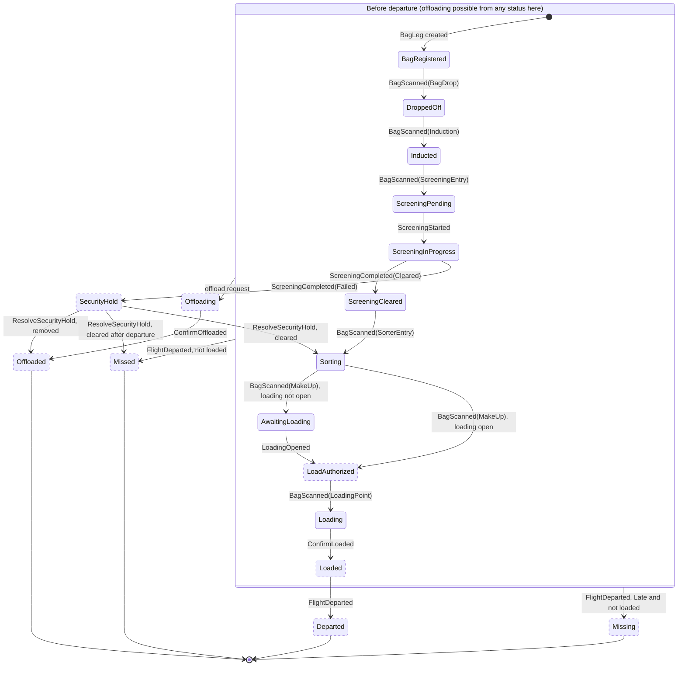
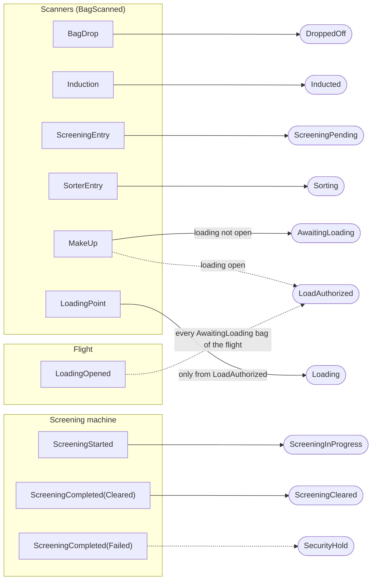

# Bag lifecycle

This document shows how a `BagLeg` (one bag on one flight) moves through its statuses, and which
fact from the simulated world leads to which status. The simulation reports **facts** (where a bag
was seen, what a machine concluded, what happened to a flight); the domain decides which
**status** that means.

Keep this document up to date in the pull request of every issue that changes the lifecycle.

## Rules

- **Forward-only.** A fact is only applied when its status comes later in the happy path than the
  current status. Earlier or equal facts (out-of-order or duplicate messages) leave the bag
  unchanged.
- **Skipping is allowed.** A missed scan must not block a bag: a later fact moves the bag forward
  past the statuses in between. The diagram does not draw these skip arrows.
  **Exception:** a bag can only reach `Loading` from `LoadAuthorized`. No unauthorized bag may end up
  on board (IATA 753).
- **Explicit order.** "Later" is defined by an explicit list of happy-path statuses in
  `BagLegStateMachine`, not by the order of the `BagStatus` enum.
- **Final statuses never change:** `Departed`, `Offloaded` (with reason), `Missed`, `Missing`.
- **Physical work needs a manual confirmation.** `Loaded` and `Offloaded` are only reached through a
  command from a ramp agent, so the automated chain never marks physical work as done on its own.
- **Late is a condition, not a status.** A bag that fails to reach its next checkpoint in time is
  marked *Late* (`IsLate`, `LateSince`) but keeps its status and can still move forward. Bags on
  security hold are never marked Late.

## Status lifecycle

Solid states can already be reached in code; dashed states are planned.

### Departure

When the simulation reports `FlightDeparted`, every bag of that flight that is not final yet is
resolved as below. The diagram only draws the main departure arrows; this table is complete.

| Status at departure | Result |
| --- | --- |
| `Loaded` | `Departed` |
| `BagRegistered` (never dropped off) | `Offloaded`, reason: not checked in |
| `SecurityHold` | Unchanged; resolved later by `ResolveSecurityHold` (removed → `Offloaded`, cleared → `Missed`) |
| `Offloading` | Unchanged; resolved later by `ConfirmOffloaded` → `Offloaded` |
| Any other status, Late | `Missing` (v1: automatic; a ramp agent may resolve a recovered bag to `Missed`) |
| Any other status, not Late | `Missed` |

`Offloading` can be entered from every non-final status before departure, including `Loaded` (for
example a passenger who did not board), except from `SecurityHold`: a held bag is removed through
its hold resolution instead. The command that starts offloading is defined in the Offloading issue.

## Facts and checkpoints → statuses

Which fact from the simulated world leads to which status. Solid arrows are implemented; dashed
arrows are planned.

`BagRegistered` is not caused by a fact: it is the starting status of every new `BagLeg`.

## Implementation status

| Part | Status |
| --- | --- |
| Happy path from `BagRegistered` to `AwaitingLoading`, and `LoadingPoint` → `Loading` | Implemented (#7) |
| `LoadingOpened`, `LoadAuthorized`, and loading only from `LoadAuthorized` | Planned (#8) |
| `ConfirmLoaded` → `Loaded` | Planned |
| `SecurityHold` and its resolution | Planned |
| `Offloading` → `Offloaded` | Planned |
| Departure rules | Planned |
| Late condition | Planned |
